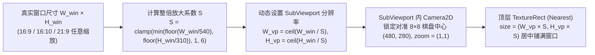

# 森林战场改造方案：连续延伸地面、战争迷雾与多屏整倍缩放

> **用途**：本方案已与作者逐项对齐全部视觉与工程决策，可直接交由 GPT / Codex 在仓库 `/Users/a488/Documents/ChatGPT/16days` 中按步骤执行。  
> **适用引擎**：Godot 4.7.2 标准版（`gl_compatibility` 渲染器，GDScript）。  
> **当前基线**：基于现有 `game/battle/`、`docs/art/battle/` 与 `tests/battle_scene_test.gd`（当前基线测试已通过 `failures = 0`）进行原地升级。

---

## 1. 作者已确认的核心决策（执行铁律，禁止偏离）

1. **取消悬空石台，棋盘与外围森林彻底融为同一连续平面**
   - 移除现有的厚岩石底座（`BoardCliffBase` / `board_cliff_base.*`），取消地形块底部的厚立体砖块切面。
   - `8×8` 可玩棋盘外侧继续按完全一致的 `2:1` 等轴网格向外延伸铺设野生森林地形（泥土、苔草、贯通小溪、林间散石与针叶松）。
2. **零人工界石/外框，纯靠「格线有无 + 光照与第 9 格压暗进迷雾」区分边界**
   - **禁止**沿 `8×8` 边界摆放界石、断木或绘制发光战术外框。
   - **`8×8` 棋盘内（`col in 0..7, row in 0..7`）**：地形块带 `1px` 柔和浅细格线，且完全处于受光通透区（零迷雾遮挡）。
   - **跨出 `8×8` 边界（第 9 格起，`col < 0` 或 `col > 7` 或 `row < 0` 或 `row > 7`）**：地面图块**不画任何格线**，并在跨过边界线瞬间开始压暗明度、进入战争迷雾。
3. **战争迷雾质感：冷灰青像素云雾（近界半透 + 远界浓雾 + 缓慢流动）**
   - **近界过渡带（边界外 `1～2` 格）**：压暗约 `34%～55%`，半透明透出下方延伸出去的泥土、草丛、蜿蜒溪流与近处树根，叠加缓慢漂移的冷灰青像素云絮。
   - **远界闭合带（边界外约 `3.8` 格起至画布边缘）**：渐入 `100%` 不透明的深冷灰青浓雾（`#0b151d`），远景松树半隐半现，最外缘与视口清屏底色完全一致，彻底消除画布接缝。
4. **多分辨率与多屏幕比例（16:9 / 16:10 / 21:9）适配：整倍像素缩放 + 外围迷雾 Overscan**
   - 核心棋盘采用 **动态整倍像素放大（Integer Scaling，`1×..6×`）**，保证 `1` 美术像素永远严格对应 `N×N` 屏幕物理像素，杜绝半像素拉伸发糊或斜向格线粗细不均。
   - 扩大世界画布至 **`960×560`（Overscan 迷雾森林画布）**，`SubViewport` 按当前窗口真实像素尺寸除以整倍系数 `scale_int` 动态取整——在 `16:9`、`16:10`（MacBook 原生屏）、`21:9` 带鱼屏或任意拉伸窗口下**全屏零黑边**，多出的视野自然露出更多外围迷雾与树影。
5. **清理非本职 UI 与自拟命名，分离角色占位**
   - **删除自拟关卡名**：代码注释、场景节点、文档与运行窗口中均**不得**再出现 AI 自拟的「寒林前哨」名称，统一使用中性描述（如「森林战场」/ `ForestBattleWorld`）。
   - **移除临时 UI 面板**：撤掉 `battle_preview.gd` 现有的顶部标题卡、右上收益卡、右下信息卡和底部 9 按钮栏（UI 与引导设计由专门模块负责，不在本战场美术场景内堆砌）。
   - **独立占位开关**：当前未定稿的人物、地精、采集器、宝箱与钻出标记仅为比例占位，统一挂在 `PlaceholderUnits` 容器下，在 `forest_battle_world.gd` 提供 `@export var show_unit_placeholders: bool = true`（`@tool` 实时生效，运行时可按 `P` 键切换显隐）。

---

## 2. 空间坐标与多屏整倍缩放数学规格



### 2.1 世界画布与等轴坐标参数（统一写入 `forest_battle_data.gd`）

| 常量名 | 数值 | 单位与几何含义 |
| --- | --- | --- |
| `WORLD_CANVAS_SIZE` | `Vector2(960.0, 560.0)` | 含外围森林与浓雾缓冲区的世界总画布尺寸（像素） |
| `BOARD_CENTER` | `Vector2(480.0, 280.0)` | `8×8` 棋盘几何正中心（即 `col=3.5, row=3.5` 处，镜头永远对准此点） |
| `TILE_HALF_W` | `24.0` | 单格 `2:1` 等轴菱形半宽（单格宽 `48 px`） |
| `TILE_HALF_H` | `12.0` | 单格 `2:1` 等轴菱形半高（单格顶面高 `24 px`） |
| `ORIGIN_A1_CENTER` | `Vector2(480.0, 196.0)` | `A1`（`col=0, row=0`）格心世界坐标：`y = 280 - 7 × 12 = 196` |
| `OUTER_MIN` / `OUTER_MAX` | `-6` / `13` | 连续铺地格坐标范围（共 `20×20 = 400` 格；其中 `0..7 × 0..7` 为可玩 `8×8` 棋盘，其余为无格线外延林地） |

- **格心正算 `cell_to_world(cell: Vector2i) -> Vector2`**：
  $$\text{world\_x} = 480.0 + (\text{col} - \text{row}) \times 24.0, \quad \text{world\_y} = 196.0 + (\text{col} + \text{row}) \times 12.0$$
  - 核对 `8×8` 四顶点外沿：上顶点 `(480, 184)`，下顶点 `(480, 376)`（总高 `192 px`），左顶点 `(288, 280)`，右顶点 `(672, 280)`（总宽 `384 px`）。
- **连续等轴浮点反算 `world_to_iso_uv(world_pos: Vector2) -> Vector2`**：
  $$\Delta x = \frac{\text{world\_x} - 480.0}{24.0}, \quad \Delta y = \frac{\text{world\_y} - 196.0}{12.0}$$
  $$u = \frac{\Delta x + \Delta y}{2.0}, \quad v = \frac{\Delta y - \Delta x}{2.0}$$
  - 当且仅当 `u in [-0.5, 7.5]` 且 `v in [-0.5, 7.5]` 时，该像素严格位于 **`8×8` 可玩棋盘菱形内部**！
  - `world_to_cell(world_pos)` 对 `round(u), round(v)` 取整后，**若不在 `0..7 × 0..7` 内一律返回 `Vector2i(-1, -1)`**，确保外围迷雾延伸区绝不误触发棋盘交互。

### 2.2 动态整倍缩放公式与主流分辨率表现验算

为保证核心 `8×8` 棋盘（`384×192 px`）加上四周至少 `1.5～2.5` 格近界迷雾森林（最小安全视口基准 **`540×310 px`**）完整入镜，整倍放大倍率 `S` 计算如下：

```gdscript
static func compute_integer_scale(win_size: Vector2) -> int:
	var sx := floori(win_size.x / 540.0)
	var sy := floori(win_size.y / 310.0)
	return clampi(mini(sx, sy), 1, 6)
```

| 屏幕 / 窗口尺寸 | 比例 | 整倍系数 `S` | `SubViewport` 像素尺寸 `ceil(win/S)` | 棋盘占屏高比例 | 边缘表现 |
| --- | --- | :---: | :---: | :---: | --- |
| `1152 × 648`（Godot 默认窗口） | 16:9 | `2×` | `576 × 324` | 59.3% | 四周露出约 2.5 格森林与流动迷雾，零黑边 |
| `1280 × 720`（720p 标准窗口） | 16:9 | `2×` | `640 × 360` | 53.3% | 标准取景，浓雾自然收边，零黑边 |
| `1440 × 900`（MacBook 常见逻辑分辨率） | **16:10** | `2×` | `720 × 450` | 42.7% | 上下自然多露出迷雾松林，**零黑边** |
| `1920 × 1080`（1080p 全高清） | 16:9 | `3×` | `640 × 360` | 53.3% | 严格 `3×3` 整数像素，构图与 720p 完全一致 |
| `2560 × 1440`（2K 桌面屏） | 16:9 | `4×` | `640 × 360` | 53.3% | 严格 `4×4` 整数像素，锐利无模糊 |
| `2560 × 1600`（MacBook Retina 满屏） | **16:10** | `4×` | `640 × 400` | 48.0% | 上下由 `960×560` 迷雾画布无缝覆盖，**零黑边** |
| `2560 × 1080` / `3440 × 1440` | **21:9** | `3×` / `4×` | `854 × 360` / `860 × 360` | 53.3% | 左右宽视野由 `960` 宽迷雾森林吃掉，**零黑边** |

> [!IMPORTANT]
> 若极端窗口下拉得比 `960×560` 世界画布还宽（如三联屏），将 `SubViewport` 的清屏背景色（`RenderingServer.set_default_clear_color` 或底层全屏 `ColorRect`）设为与 `battle_fog_of_war.gdshader` 远端 `fog_deep_color` **完全一致的 `#0b151d`（`Color(0.043, 0.082, 0.114, 1.0)`）**，即可在任何极端宽高比下做到视觉无限延伸、绝对零接缝。

---

## 3. 美术资产改造清单与 `.pxo` 分层核验规范

### 3.1 需新增 / 替换的像素图块（保存源件于 `docs/art/battle/`，导出贴图于 `game/battle/art/`）

1. **移除旧悬空石台依赖**：从场景引用中移除 `board_cliff_base_albedo.png` / `board_cliff_base_normal.png`（历史文件可删或归档，不再加载）。
2. **平铺无缝内/外地形块（统一 `48×32` 画布，顶面 `48×24` 菱形位于 `y = 4..27`）**：
   - **取消厚侧面砖墙裙边**：不再画深色立体块厚度，仅在菱形下半边缘向下填 `1px` 同色防缝保护边（`y + 1`），使所有相邻地块融成一片连续大地。
   - **棋盘内图块（含 `1px` 浅细格线独立图层）**：
     - `tile_plain`（冻土底色 `#3b3531` + 浅格线层 `#4d4540` / `#2f2a27` + 少量土砾层）
     - `tile_grass`（松绿底色 `#284d3e` + 浅格线层 `#3a6955` / `#1e382d` + 像素草叶簇层）
     - `tile_grass_burning`（焦黑底色 `#2b211f` + 浅格线层 + 余烬裂点层）
     - `tile_water`（取消之前的四边封闭亮青方框！改为连贯深青溪水底色 `#1f5368` + 浅格线层 `#367d96` + 顺流向像素水波纹层，使 `C3-D3-C4` 与边界外延伸溪水自然贯通，水陆交界处靠草岸/浅滩过渡）
     - `tile_rock_intact` / `tile_rock_cracked`（`48×44`，底层为带浅格线的连续冻土层，上层为高出地面的花岗巨石层与裂纹层）
   - **边界外无格线图块（完全不含格线层，底色与棋盘内同名地形逐字节一致）**：
     - `tile_plain_outer`（`48×32`：连续冻土层 + 野生苔点土砾层）
     - `tile_grass_outer`（`48×32`：连续松绿底色层 + 野生草叶簇层）
     - `tile_water_outer`（`48×32`：连续溪水底色层 + 水波纹层，供溪流从西北迷雾流入棋盘、向东南流出棋盘）
     - `tile_rock_outer`（`48×44`：无格线冻土层 + 林间野生岩石层）
3. **大画幅底层林地底图 `bg_cold_forest`（升级为 `960×560`）**：
   - 去掉旧版天空分界线（等轴俯视连续地面不应在画面上方 `y=70` 突然断成横切夜空！整张 `960×560` 均为连续延伸的暗调林地底纹，远端全部由松林与战争迷雾自然收束）。

### 3.2 严格执行 `AGENTS.md` 的 `.pxo` 图层归属与回读核验要求

> [!WARNING]
> 按 `AGENTS.md` 2026-11-27 规范：**不能以合成图颜色正确代替分层正确**。每个 `.pxo` 必须按语义明确命名图层（例如 `连续等轴地表层`、`8x8 浅细格线层`、`地表自然肌理层`、`花岗巨石主体层`、`碰撞裂纹层`），**格线像素严禁混入地表底色层或肌理层，边界外 `*_outer.pxo` 严禁残留格线像素**。保存 `.pxo` 后必须用脚本按图层名称回读全部图层：
> 1. 校验轮廓外无杂点、`*_outer` 图块无格线残留；
> 2. 校验 `.pxo` 全图层合成结果与导出的 `_albedo.png` 逐像素一致；
> 3. 校验配对 `_normal.png` 与 `_albedo.png` 尺寸及透明通道（Alpha）逐像素一致；
> 4. 生成并目视检查全图层联系表 PNG。

---

## 4. Shader 与脚本实现细则

### 4.1 等轴战争迷雾 Shader：`game/battle/battle_fog_of_war.gdshader`

挂载于 `ForestBattleWorld` 内高于地面与近树、覆盖整个 `960×560` 世界画布的 `ColorRect`（`z_index = 60, mouse_filter = MOUSE_FILTER_IGNORE`）：

```glsl
shader_type canvas_item;
render_mode unshaded;

// A1(0,0) 格心世界坐标，与 ForestBattleData.ORIGIN_A1_CENTER 保持一致
uniform vec2 origin_a1_center = vec2(480.0, 196.0);
// 单格等轴半宽与半高（48x24 菱形对应 24, 12）
uniform vec2 tile_half = vec2(24.0, 12.0);
// 迷雾节点在世界空间覆盖的起点与尺寸（像素）
uniform vec2 rect_origin = vec2(0.0, 0.0);
uniform vec2 rect_size = vec2(960.0, 560.0);
// 远端闭合浓雾颜色（#0b151d，须与视口最外围清屏底色一致）
uniform vec3 fog_deep_color : source_color = vec3(0.043, 0.082, 0.114);
// 近界漂浮像素冷青云絮亮色
uniform vec3 fog_mist_color : source_color = vec3(0.145, 0.245, 0.305);
// 跨过 8x8 边界（第 9 格起始处）的基础压暗透明度
uniform float border_dim_base : hint_range(0.0, 0.7) = 0.36;
// 从边界到完全闭合浓雾的过渡宽度（格）：3.8 表示外 1~2 格半透出森林与溪流，再往外没入浓雾
uniform float full_fog_tiles : hint_range(1.5, 8.0) = 3.8;
// 像素云雾缓慢漂移速度（世界像素/秒）
uniform vec2 drift_velocity = vec2(3.0, 1.3);

float hash12(vec2 p) {
	vec3 p3 = fract(vec3(p.xyx) * 0.1031);
	p3 += dot(p3, p3.yzx + 33.33);
	return fract((p3.x + p3.y) * p3.z);
}

float value_noise(vec2 p) {
	vec2 i = floor(p);
	vec2 f = fract(p);
	vec2 u = f * f * (3.0 - 2.0 * f);
	return mix(
		mix(hash12(i), hash12(i + vec2(1.0, 0.0)), u.x),
		mix(hash12(i + vec2(0.0, 1.0)), hash12(i + vec2(1.0, 1.0)), u.x),
		u.y
	);
}

float fbm_mist(vec2 p) {
	return 0.58 * value_noise(p)
		+ 0.29 * value_noise(p * 2.03 + vec2(17.1, 9.4))
		+ 0.13 * value_noise(p * 4.07 + vec2(5.3, 28.7));
}

void fragment() {
	// 对齐 1x1 世界像素网格，杜绝高清平滑渐变破坏像素风格
	vec2 world_px = rect_origin + floor(UV * rect_size) + vec2(0.5);
	vec2 rel = (world_px - origin_a1_center) / tile_half;
	float u = (rel.x + rel.y) * 0.5;
	float v = (rel.y - rel.x) * 0.5;

	// 8x8 棋盘内部严格对应 u in [-0.5, 7.5], v in [-0.5, 7.5]
	float dx = max(-0.5 - u, u - 7.5);
	float dy = max(-0.5 - v, v - 7.5);
	vec2 outside_v = max(vec2(dx, dy), vec2(0.0));
	float outside_dist = length(outside_v) + min(max(dx, dy), 0.0);

	if (outside_dist <= 0.0) {
		COLOR = vec4(0.0);
	} else {
		vec2 coarse_px = floor((world_px + TIME * drift_velocity) / 3.0);
		vec2 fine_px = floor((world_px - TIME * drift_velocity * 0.55) / 2.0);
		float cloud = fbm_mist(coarse_px * 0.075) * 0.68 + fbm_mist(fine_px * 0.12 + vec2(11.0, 23.0)) * 0.32;

		float norm_d = clamp(outside_dist / full_fog_tiles, 0.0, 1.0);
		float edge_step = smoothstep(0.0, 0.08, outside_dist);
		float raw_alpha = mix(
			border_dim_base + (cloud - 0.5) * 0.12,
			1.0,
			smoothstep(0.04, 1.0, norm_d + (cloud - 0.48) * 0.20)
		) * edge_step;
		raw_alpha = clamp(raw_alpha, 0.0, 1.0);

		float q_alpha = raw_alpha > 0.93 ? 1.0 : floor(raw_alpha * 7.0 + 0.35) / 7.0;
		float wisp = step(0.53, cloud) * (1.0 - smoothstep(0.16, 0.90, norm_d));
		float soft_wisp = step(0.44, cloud) * 0.45 * (1.0 - smoothstep(0.24, 0.94, norm_d));
		vec3 fog_rgb = mix(fog_deep_color, fog_mist_color, clamp(wisp * 0.65 + soft_wisp * 0.35, 0.0, 0.70));
		fog_rgb = mix(fog_rgb, fog_deep_color, smoothstep(0.72, 0.98, q_alpha));

		COLOR = vec4(fog_rgb, q_alpha);
	}
}
```

### 4.2 连续延伸地形与溪流贯通规则：`game/battle/forest_battle_data.gd`

1. **命名清理**：将 `COLD_WOODS_ROWS`、`create_cold_woods()`、`reset_cold_woods()` 统一改名为中性的 `FOREST_STAGE_ROWS`、`create_forest_stage()`、`reset_forest_stage()`（保留原 8×8 试算布局不变）。
2. **新增外延地形查询 `outer_terrain_at(cell: Vector2i) -> int`（用于 `col, row in -6..13` 且不在 `0..7 × 0..7` 内的格子）**：
   - **贯通小溪**：让棋盘内的 `C3(2,2)`、`D3(3,2)`、`C4(2,3)` 水地自然向西北与西南/东南林间延伸——例如将 `(2, 1)?` 注意 `(2,1)` 是棋盘内的 `C2`（普通地），不要改动 `8×8` 内部配表！改为在棋盘边界外做**第二条环林支流或从边缘接入**，或在西北外侧 `(-3, 2)..(-1, 2)`、`(2, -3)..(2, -1)` 及东南外侧 `(8, 3)..(11, 3)` 布置林间溪水，让边界外 `1～2` 格半透迷雾区能看到水脉在森林中延续。
   - **野生草地过渡**：在紧贴棋盘草地（如 `B1/C1` 北侧 `(1,-1),(2,-1),(1,-2)`、`A7` 西侧 `(-1,6),(-2,6),(-1,5)`、`H5` 东侧 `(8,4),(9,4)`、`F8/G8` 南侧 `(5,8),(6,8),(6,9)`）向外自然延续 `1～3` 格 `GRASS`，其余按确定性哈希穿插 `PLAIN`、`GRASS` 与少量外圈 `ROCK`（避开紧贴边界第 9 格正前方以防视觉误判为界石！岩石只放在距离边界 `>= 2` 格的外林区）。

### 4.3 世界场景结构重构：`game/battle/forest_battle_world.tscn` & `.gd`

节点层级顺序（自底向上）：
1. `Backdrop`（`Sprite2D`，`960×560` `bg_cold_forest`）
2. `ContinuousTerrain`（`Node2D`：按等轴深度 `depth = col + row` 从 `-12` 到 `26` 依次生成 `20×20` 连续地块；其中 `0..7 × 0..7` 使用带浅细格线的 `tile_*`，外延格使用无格线的 `tile_*_outer`）
3. `OuterForestProps`（`Node2D`：在 `outside_dist >= 1.2` 格的外延林地上按等轴深度 `z_index = (col + row) * 2 + 2` 错落摆放 CC0 针叶松、覆雪松、枯松、树桩、灌木、蘑菇、原木堆与守望火盆；**严禁任何树冠像素侵入 `0..7 × 0..7` 棋盘菱形内部**）
4. `PlaceholderUnits`（`Node2D`：受 `@export var show_unit_placeholders: bool = true` 控制显隐，存放采集器、宝箱、3 名角色占位、地精占位与钻出裂隙标记；脚本内用 setter 保证在 Godot 2D 编辑器勾选/取消时实时显隐）
5. `AmbientMoonlight`（`CanvasModulate`，偏冷夜林底光）+ `BoardKeyLight`（**仅柔和照亮中央 `8×8` 棋盘**，配合迷雾强化“内亮外暗”的边界感）+ `DynamicLights`
6. `FogOfWarLayer`（`ColorRect`，位置 `(0, 0)`，尺寸 `(960, 560)`，`z_index = 60`，绑定 `battle_fog_of_war.gdshader`，把边界外地面和外围松林按距离半透/浓雾笼罩）
7. `WorldCamera`（`Camera2D`，`position = Vector2(480, 280)`，`enabled = true`）

### 4.4 纯净多屏整倍缩放入口：`game/battle/battle_preview.tscn` & `.gd`

1. **全屏深雾兜底背景**：根 `Control` 下首层放全屏 `ColorRect`（颜色固定 `Color(0.043, 0.082, 0.114, 1.0)`，即 `#0b151d`，与 `fog_deep_color` 完全相同）。
2. **动态整倍 `SubViewport`**：
   - 监听根 `Control` 的 `resized` 信号：
     ```gdscript
     var s := BattleData.compute_integer_scale(size)
     var vp_w := maxi(1, ceili(size.x / float(s)))
     var vp_h := maxi(1, ceili(size.y / float(s)))
     world_view.size = Vector2i(vp_w, vp_h)
     world_display.size = Vector2(vp_w * s, vp_h * s)
     world_display.position = ((size - world_display.size) * 0.5).floor()
     ```
   - `ForestBattleWorld` 内的 `WorldCamera` 固定在 `BOARD_CENTER (480, 280)`，`zoom = Vector2.ONE`。
   - **鼠标屏幕坐标转世界坐标公式**（用于顶层高清悬停格框）：
     $$\text{world\_pos} = \text{BOARD\_CENTER} + \frac{\text{mouse\_pos} - \text{world\_display.position}}{S} - \frac{\text{Vector2}(\text{vp\_w}, \text{vp\_h})}{2.0}$$
3. **纯净无面板表现 + 轻量开发快捷键**：
   - 默认不渲染任何文字标题栏、统计框或按钮条；鼠标移入 `8×8` 棋盘内时仅在顶层 `BoardOverlay` 绘制 `1` 个干净的高清悬停菱形框（移入边界外迷雾区时不显示格框）。
   - 保留轻量键盘测试热键（仅开发调试用，不画 UI 遮挡画面）：
     - `P`：切换 `show_unit_placeholders`（纯看地形迷雾场景 vs 看带占位角色效果）
     - `F`：切换草地燃烧动态火苗与火光测试
     - `C`：测试石块一次碰撞裂纹 / 二次碎裂变普通地
     - `R`：重置战场初始状态

---

## 5. 验证与交付清单（GPT 执行完毕前必须逐项跑通）

1. **Pixelorama `.pxo` 分层回读审计**：
   - 运行回读检查脚本，确认新增/更新的所有 `.pxo` 图层命名明确、`*_outer.pxo` 不含任何格线像素、合成图与 `_albedo.png` 逐像素一致、`_normal.png` Alpha 逐像素对齐，并输出图层联系表供人工抽检。
2. **更新并跑通无窗口自动测试 `tests/battle_scene_test.gd`**：
   ```sh
   godot --headless --editor --path game --import
   godot --headless --path game --script ../tests/battle_scene_test.gd
   godot --headless --path game --script ../tests/expedition_test.gd
   godot --headless --path game --script ../tests/economy_test.gd
   ```
   `battle_scene_test.gd` 须覆盖：
   - `0..7 × 0..7` 共 64 格坐标正反算与地形配置正确；
   - 边界外坐标（如 `(-1, 0)`、`(8, 4)`、`(3, -2)`）存在无格线外延地形，且 `world_to_cell` 对边界外像素严格返回 `Vector2i(-1, -1)`；
   - `compute_integer_scale` 在 `1152×648` (`2×`)、`1280×720` (`2×`)、`1440×900` (`2×`)、`1920×1080` (`3×`)、`2560×1440` (`4×`)、`2560×1600` (`4×`) 下返回预期整数倍率；
   - `show_unit_placeholders = false / true` 切换正常，战争迷雾材质与法线贴图全部有效绑定，`failures == 0`。
3. **真机 OpenGL 多比例截图目视验收（禁止只用无窗口模式代替目视检查）**：
   - 使用不带 `--headless` 的真实渲染脚本分别截取：
     - `1280 × 720`（`16:9`，开启占位角色）
     - `1280 × 720`（`16:9`，`show_unit_placeholders = false` 纯森林迷雾场景）
     - `1440 × 900`（`16:10` Mac 比例）
     - `1680 × 720`（`21:9` 超宽比例）
   - 逐张核对：悬空石台已彻底消失、`8×8` 内外地面无缝融合、仅 `8×8` 内有浅细格线、第 9 格起自然压暗进入冷灰青像素云雾、外 1–2 格隐约可见延伸树林与溪流、所有宽高比下四边无黑边无接缝、无任何自拟关卡名或多余 UI 面板。
