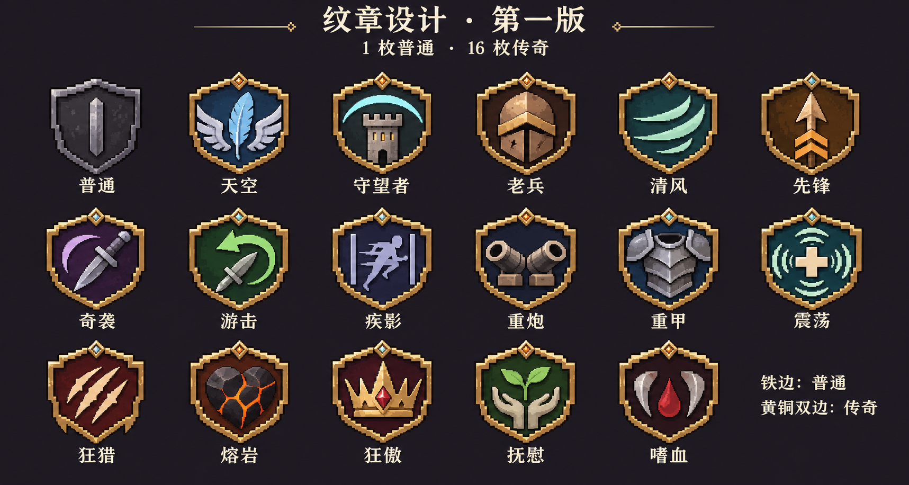

# 纹章视觉提案 v1

2026-11-26，用户要求设计纹章。Codex 按当前纹章候选名单，使用内置 image_gen 生成一张全套视觉提案。状态：待作者视觉确认，未接入 Godot，未改变玩法或原策划。

依据：`docs/design/纹章设计文档.md`、`docs/design/游戏美术.md`、`docs/美术需求清单.md`。当前工作树中的候选名单共 17 枚；本提案不代表名单与能力已定稿。

普通纹章采用简洁铁边，传奇纹章采用黄铜边框和顶部菱形。中央图案对应能力，以轮廓、图案和配色共同区分。图中顺序与候选名单一致。

已目视核对 17 枚图标数量、名称及图案对应关系。这是大尺寸概念总览，不是经过逐像素整理的 32×32 成品图集；尚未验证实际商店尺寸下的可读性，也未交付透明单图、可编辑分层或装备／锁定／遗失／赎回状态。作者选定方向后再进行正式资产制作与场景验收。

生成方式：OpenAI 内置 image_gen；无外部素材拼贴。AI 生成记录供赛事声明整理使用，不将其标记为第三方 CC0 素材。

完整提示词：[prompt-v1.txt](prompt-v1.txt)。
